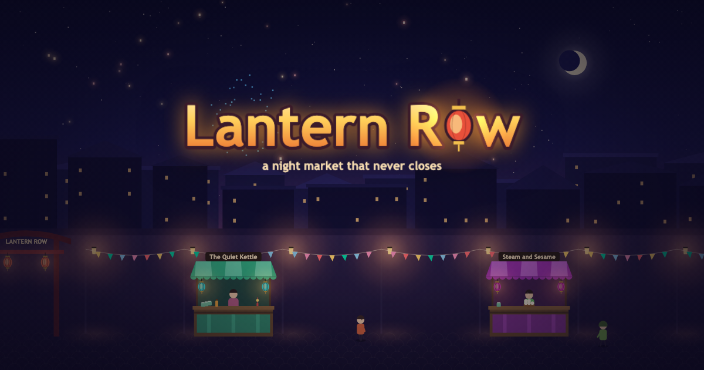
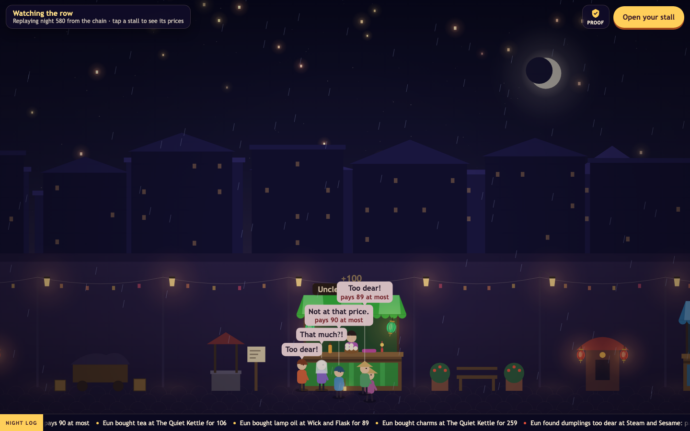
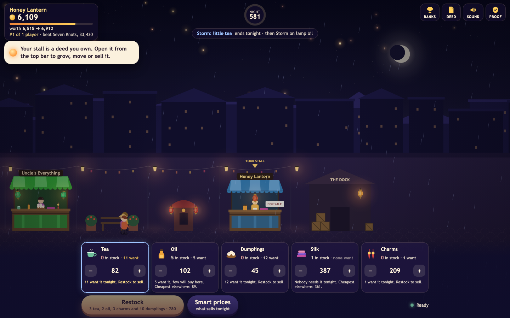
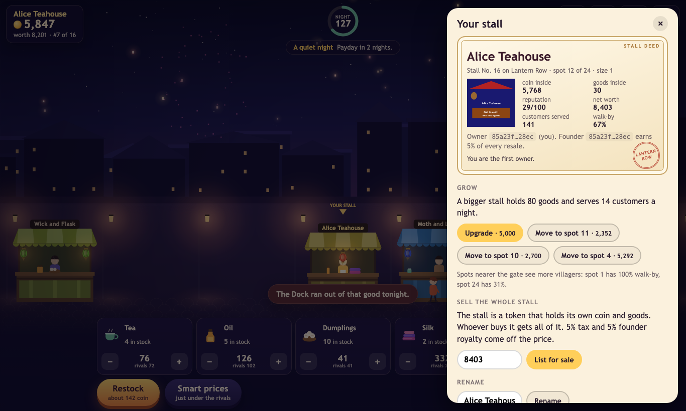
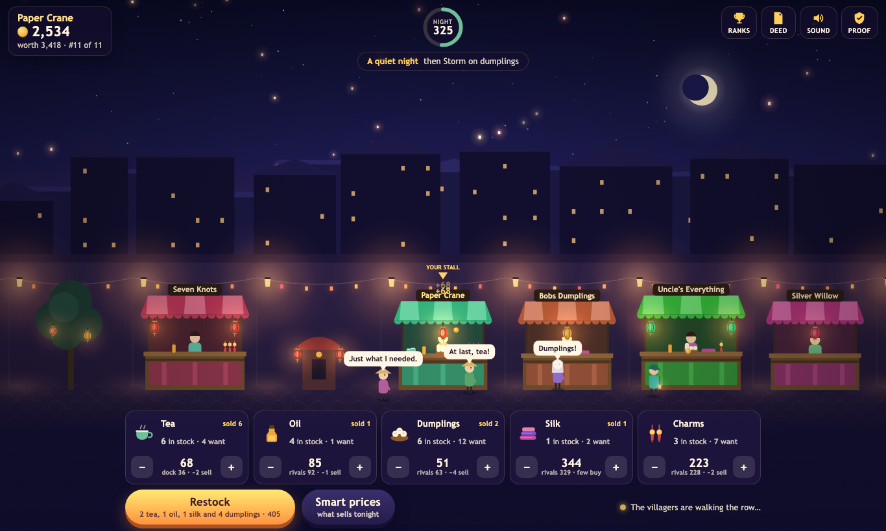

<p align="center"></p>

# Lantern Row

[](https://github.com/replaycourt/lantern-row/actions/workflows/ci.yml)

<table>
<tr>
<td width="40%"></td>
<td width="40%"></td>
<td width="20%"></td>
</tr>
<tr>
<td><sub><b>Watch the row</b> without an account: the latest nights replayed from the chain's own night logs, with the reason behind every "Too dear!".</sub></td>
<td><sub><b>Play</b>: worth against the next milestone, your place among the players, price cards in plain sentences.</sub></td>
<td><sub><b>The deed</b>: the stall as an NFT that holds its coin and goods.</sub></td>
</tr>
</table>

<sub>Screenshots of the page against the live testnet contract, taken with headless Chrome and no transaction; the two in-game shots show an existing player's stall, opened read-only.</sub>

**Run a stall, price your goods, out-trade the merchants.** A night market nobody can close: a shared, lantern-lit street where twelve villagers with their own wallets, tastes and memories walk the row every 20 seconds and buy what they need. Every night brings one call to make: stock up before the festival, wait for the Dock to get cheap, undercut The Quiet Kettle on what everyone wants tonight. Grow your stall, and sell it whole when you are done. Built at NEAR HACKATHON for the `games` and `nfts` tracks.

**No server, no owner, no admin key.** The whole game is one NEAR contract, and that contract account holds no access keys at all: nobody, its author included, can redeploy it, change a rule, mint coin or take anyone's stall. The page is static files, and every move is signed in your browser and checked by the contract. One million coin existed at founding, and `audit()` still counts exactly one million.

**Play now:** https://replaycourt.github.io/lantern-row/web/ (testnet, play money, no sign-up)

**Demo video (two minutes of real play on testnet):** [web/media/lantern-row-demo.mp4](web/media/lantern-row-demo.mp4), captions in [demo/video/lantern-row-demo.srt](demo/video/lantern-row-demo.srt). How it was made: [demo/video/README.md](demo/video/README.md).

**Judging?** [JUDGE.md](JUDGE.md) is a five-minute path: what to tap, what you should see, the one-command checks, and where each claim lives in the code. `scripts/judge-checks.sh` runs the five checks at once and prints PASS or FAIL.

**Check it without an account.** Plain curl against the public testnet RPC; python3 only decodes the view result, which the RPC returns as bytes.

```sh
# The game contract has no access keys. Expect: "keys":[]
curl -s https://test.rpc.fastnear.com -H 'Content-Type: application/json' -d '{"jsonrpc":"2.0","id":1,"method":"query","params":{"request_type":"view_access_key_list","finality":"final","account_id":"lantern-row.testnet"}}'; echo

# Coin is never created or destroyed. Expect: {"founding":1000000,"total":1000000,...}
curl -s https://test.rpc.fastnear.com -H 'Content-Type: application/json' -d '{"jsonrpc":"2.0","id":1,"method":"query","params":{"request_type":"call_function","finality":"final","account_id":"lantern-row.testnet","method_name":"audit","args_base64":"e30="}}' | python3 -c 'import json,sys; print(bytes(json.load(sys.stdin)["result"]["result"]).decode())'
```

**How it fits the tracks.** The last column says where each claim can be seen: **live** means a view of the deployed contract that anyone can call now; **tests** means the contract's tests; **simulation** means the bot-driven economy runs in [docs/ECONOMY.md](docs/ECONOMY.md).

| Prompt | In Lantern Row | Evidence |
|---|---|---|
| `games`: NPCs with wallets | Twelve villagers each hold a wallet, earn a wage and spend it on what they need. Six merchant stalls restock out of their own coin by fixed rules. | live: `world().villagers`, `leaderboard()` |
| `games`: player-owned markets | A player's stall is a token they own: they stock it, price it, move it, grow it and sell it to another stall. | live: `stall`, `nft_token`; tests |
| `games`: economies that evolve without a dev patch | No keys, no admin method. Dock prices, wages, events and merchant prices move by the contract's own rules, and the first player action closes the nights that are due. | live: no access keys, `audit()` = 1,000,000; how prices and fortunes move over a thousand nights: simulation |
| `games`: players never notice the chain | No wallet, sign-up, seed phrase or gas fee. The browser makes its own key, a pool of public relay keys pays the gas, and transaction hashes and gas stay out of sight unless you open the *Proof* drawer. | live: the gas account's keys |
| `nfts`: NFTs as accounts that own money | A stall's coin is stored under its token id and goes wherever the token goes. | live: `nft_token` |
| `nfts`: earn royalties | A stall earns coin from every villager it serves. Its founder gets 5% of every resale, in coin on the row and in NEAR through `nft_payout`. | tests; one scripted resale on testnet in [docs/testnet-run.md](docs/testnet-run.md) |
| `nfts`: hold inventory | Goods, prices, reputation and spot are stored under the token id too. The token's picture and description are computed from them. | live: `nft_token` |

<p align="center"></p>

## How to play

**Watch first, if you like.** The title screen replays the latest nights from the chain, with a ticker of real sales and refusals; *Watch the row first* clears the screen so you can drag along the street and tap any stall for its prices and why, while a board ranks every stall by its takings that night. Nothing is sent. If nobody has played for a while, the title says so: the contract only moves when someone calls `advance_night`, and the first player action catches up the missed nights, up to 30 at once.

1. **Tap *Open your stall*.** See a stall with your name on it appear on the street, with 3,000 coin inside. No wallet, no sign-up: your browser made a key, and that key owns the stall.
2. **Tap *Restock*.** See tea, oil and dumplings land on your counter, bought from the Dock at tonight's prices and priced to sell. Each card says in a sentence how many villagers want that good tonight, about how many will buy at your price and what the cheapest rival asks; nudge a price with − and + and watch it change. Tap a card for the whole story.
3. **Wait for the clock.** See Bao, Cora and the others walk the row, stop at stalls, and buy, with coins flying to your stall and little remarks: "At last, tea!", or "Too dear!" with the reason under it, worked out the way the contract decides ("pays 83 at most", "paid 57 elsewhere").
4. **Read the night report.** See what sold, what sold out while others still wanted it, who walked away and why, and what it cost you in rent.
5. **Make tonight's call.** Under the report, one decision with two buttons: "Festival of silk starts next night: stock 3 silk?", "Bumper dumplings tomorrow: wait for cheap dumplings?", "11 want dumplings and the merchants hold 4: stock 6 at 43?" The next report says how it went, with a stamp when it paid off. Tap Restock alone and the stall still does fine; the call is where the coin is.
6. **Watch the banner.** See a festival or a storm named a night ahead, with bunting and fireworks or rain and dim lanterns when it comes.
7. **Open *Deed*.** See your stall as the token it is: a deed card with its coin, goods, reputation, spot and founder royalty, and under it the picture the contract itself draws for the token. Grow it, move it nearer the gate, or list it for sale and watch the "FOR SALE" sign go up.
8. **Watch your goals.** The top bar shows your stall's worth against the next milestone (the contract's own prices: a bigger stall at 5,000, the front spot at 6,912, and so on), your place among the players, and the next merchant to beat. A short note pops up when you pass one.
9. **Open *Ranks*.** See the players on the row first, then the six merchants, and the stalls that lost their spot folded under "closed stalls" (tap to open). Open the page in a second browser and you will find your first stall already on the street.
10. **Race for the Lantern Cup.** Every clock hour is a new race, shown in the top bar, at the top of *Ranks* and beside the watched street. It ranks what each stall took in this hour per coin it was worth when the hour began (counted as at least 3,000), so a new stall that sells well can beat merchants that hold more than ten times its coin and take in many times as much. The page works it out from the chain alone: every stall's takings and worth read at the hour's first block (a view at that block height) and now.

Two minutes is enough to learn it. The merchants are the thing to beat: they reprice by readable rules (tap any stall to see their prices and why), and the client reads the villagers the way the contract does, so a watchful player undercuts them where it counts.

## Why NEAR

- **An unpatchable shared world.** The contract account has no access keys. Nobody, including its author, can change a rule, mint coin or move a stall. 1,000,000 coin existed at founding and `audit()` shows the same total every night since. The economy keeps running without a developer: villagers earn wages, merchants restock from their own money, rent and tax flow back to the Treasury.
- **NFTs that hold money and stock.** A stall is a NEP-171 token (metadata, approvals, enumeration, payouts), and everything the stall owns travels with it: coin, goods, prices, reputation and spot are stored in the game contract under the token id (not in a separate NEAR sub-account). Transfer it, and all of it goes along. The coin is the game's play money, not a NEAR token. Its picture and description are computed from the live stall. The founder gets a 5% royalty on every resale: on the row in coin, and through `nft_payout` for a sale in NEAR on a marketplace (tested in `contract/tests/nft.rs`; no NEAR sale has happened on testnet yet).
- **No-wallet play through scoped keys.** The browser's Ed25519 key signs `lantern-row:v1:<contract>:<nonce>:<actions>`; a pool of public function-call keys on a gas account relays it to `act`, which checks the signature. The relay keys can only call `act` and `advance_night`, so they cannot change anything a player did not sign. Players never see a transaction, a seed phrase or a gas fee, and a small *Proof* drawer shows judges the account, the token and every transaction hash.
- **Cheap enough for a 20-second night.** An `act` with ten actions burns under 3 Tgas; the worst-case `advance_night` with a full row and 30 nights of catch-up burns 15 Tgas. Playing clients call `advance_night` themselves when a night is due (a page that only watches never does), so the town is as alive as its players. During judging, a keeper in GitHub Actions also ends due nights every five minutes, beside five labelled house bots.

## Run it yourself

The client is a static site with no build step and no dependencies: `web/index.html`, CSS, and ES modules. Serve the repository root with any static server and open `/web/`:

```sh
python3 -m http.server 8765 --bind 127.0.0.1
# then open http://127.0.0.1:8765/web/
```

It needs a browser with Ed25519 in WebCrypto: Chrome 137+, Safari 17+, Firefox 130+. The page has a strict Content-Security-Policy (`default-src 'self'`; connections only to the two testnet RPC hosts) and loads nothing from a CDN.

**Tests.** Unit tests for the client's logic and the NEAR layer (signing, borsh, key rotation, the action queue) run with Node 22+ and no install, in about five seconds:

```sh
node --test 'web/test/*.test.mjs'
```

The contract's tests and economy simulation run with `cd contract && cargo test`. Expect a cold build of 15 minutes or more on a laptop: it compiles near-sdk and the test dependencies first. The 167 tests themselves then run in about 30 seconds, most of it the economy simulation. [CI](.github/workflows/ci.yml) runs both test suites on every push.

**End-to-end on testnet.** `scripts/e2e-browser.mjs` drives the real page in two headless Chrome profiles at once (one laptop, one phone) through the DevTools protocol: each founds or resumes a stall, restocks and reprices through the buttons, watches ten nights pass, answers tonight's call, reads the report and how the call went, opens the deed, lists the stall and withdraws it, and checks the other player on the leaderboard. It prints every transaction hash.

```sh
node scripts/e2e-browser.mjs --url http://127.0.0.1:8765/web/ --nights 10 --out e2e-out
```

The last run and its transactions are in [docs/testnet-run.md](docs/testnet-run.md).

**Contract.** `contract/` holds the Rust source, tests and economy simulation. `contract/build.sh --check` rebuilds the wasm with the toolchain pinned in `contract/rust-toolchain.toml` and cargo-near 0.22 and compares its sha256 with `contract/WASM_SHA256`, the code hash on chain. A cold build took 22 minutes on a 4-core laptop. It reproduced the hash on macOS (x86_64); CI repeats the build on Linux and writes in its job summary whether the hash matches there too. [SPEC.md](SPEC.md) has every rule, number and the full API; [docs/ECONOMY.md](docs/ECONOMY.md) has the simulation evidence.

## The games prompt, point by point

The track's [prompt](https://github.com/nearai/near-hackathon-prompt-examples/blob/main/tracks/09-games.md) asks for a market town with merchant agents. What Lantern Row has, and what it does not:

| The prompt asks for | Lantern Row | Where |
|---|---|---|
| A market town where players trade with NPC merchants | A night market: players run stalls next to six merchant NPCs, and twelve villagers with wages and needs buy from whoever offers the better deal | `contract/src/night.rs` |
| Each merchant has its own wallet and inventory and prices from stock and demand | Each merchant's stall holds its own coin and goods. Every night it raises a price that sold out or sold well, cuts one that villagers walked away from, keeps a margin over the Dock, and restocks from its own coin | `run_merchants` in `contract/src/night.rs`, numbers in `contract/src/config.rs` |
| Flood the market and the price falls | Undercut a good and the villagers refuse the merchants' price, so the merchants cut it night after night; buying a good at the Dock heats its price there | `run_merchants`, `dock_marginal` in `contract/src/market.rs` |
| A broke merchant closes until someone invests | **Not built.** The Treasury props a merchant up below 1,500 coin so the row never goes dark. Player stalls that stop trading lose their spot | `MERCHANT_RELIEF` in `contract/src/config.rs` |
| Items as NEP-245 multi tokens | **Not built.** Goods are counters inside each stall; the stall itself is a NEP-171 token | `contract/src/nft.rs` |
| Social or email login; no seed phrase, wallet popup or gas prompt | No login at all: the browser makes a key and public relay keys pay the gas. No seed phrase, popup or gas prompt anywhere in the loop | `web/js/near.js`, `act` in `contract/src/lib.rs` |
| Merchant pricing rules in one readable file, reasoning in a tooltip | One function with its numbers beside it; tap a merchant's stall to see each price with its reason ("villagers walked away, price cut") | `run_merchants`, `NOTE_NAMES` in `contract/src/config.rs` |
| A fast-forward mode | *Fast-forward 300 nights* on the title screen plays 300 nights in a minute: what villagers paid for each good, and the stalls by worth. It is a recording of the contract's own code in the test VM, not the live town: four player bots trade, and from night 120 a fifth floods the row with tea, so what villagers pay for tea falls by about 14 %. Longer runs (1,500 nights) are in [docs/ECONOMY.md](docs/ECONOMY.md) | `record_fast_forward` in `contract/tests/economy_sim.rs`, `web/js/fastforward.js` |
| The loop at 30 seconds, 5 minutes, one session | Every 20-second night villagers walk the row and buy; every few minutes you restock, reprice and make tonight's call; over a session you grow the stall, move up the row and pass the next merchant | [How to play](#how-to-play) |

## What is real and what is not

- **Testnet only.** The contract is `lantern-row.testnet`. Nothing runs on mainnet, and nothing here should.
- **Play money.** Coin is an integer inside the contract. It has no value and is not a token. Testnet NEAR only pays gas and storage.
- **The gas keys are public, on purpose.** They are in [`web/js/gas-keys.js`](web/js/gas-keys.js) with the reasoning. Anyone can spend their allowance, which stops free play until the pool is refilled. They cannot touch game state. The gas account's full-access key is not in the repository.
- **Economy evidence comes from bots, not humans.** The tables in `docs/ECONOMY.md` come from scripted strategies driving the real contract code. They show the rules hold together, not that people find it fun. The nights played by humans so far are the author's own.
- **House bots.** Five stalls named "Bot - …" (Tin Kettle, Brass Ladle, Paper Moon, Copper Wick, Silk Purse) are run by a script, not by people, to keep the town alive during judging. The page tags them *house bot*. Their strategies are in [`scripts/house-bots.mjs`](scripts/house-bots.mjs), and they run in GitHub Actions ([`.github/workflows/town.yml`](.github/workflows/town.yml)), not on anyone's computer. They play by the same contract rules as everyone: their own keys, the same starter grant, `act` through the same public gas keys. They tend their stalls only every few minutes, never grow and leave a quarter of the Dock to others, so they can be beaten. Players who beat them beat real, fixed-rule traders.
- **The town only moves when someone calls `advance_night`.** The same workflow runs a keeper that ends due nights every five minutes, so no night is lost to the 30-night catch-up limit. Between its calls, and if it ever stops, the contract stands still until the next player action catches up at most 30 nights; longer gaps are slept through. A watchdog workflow ([`.github/workflows/watch.yml`](.github/workflows/watch.yml)) checks the town every hour (the read-only judge checks, the gas pool, that nights keep ending and that the bots and keeper are running) and alerts the maintainer when something breaks. The title screen's street is a replay of the latest night logs, not a live feed.
- **NPCs are rules, not AI.** Villagers and merchants follow deterministic rules in the contract. No model runs at play time.
- **AI-generated code.** All code and documentation in this repository were written by an AI coding agent (Claude) from a human's game brief, during the hackathon window, and were not reviewed line by line by a human. The tests, the simulation, the testnet run and the end-to-end check are the evidence that it works. The contract has not been audited.
- **Known limits** (randomness, griefing of licences, the account register, idle towns) are listed honestly in [SPEC.md section 14](SPEC.md#14-honest-limits).

The same author also entered the independent project Bonfire, https://github.com/replaycourt/bonfire, in this hackathon.

## Credits

Original art, drawn in code (Canvas 2D and inline SVG). System fonts. Sounds synthesised in WebAudio. Libraries: near-sdk and near-contract-standards in the contract; ed25519-dalek and near-parameters in its tests only. The client and the scripts use nothing beyond the browser and Node's standard library.

## License

MIT, see [LICENSE](LICENSE).
